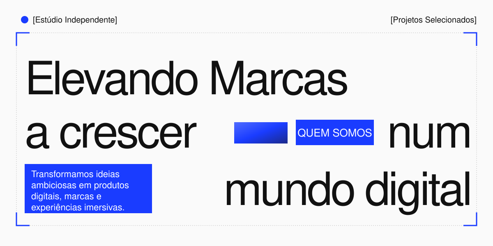
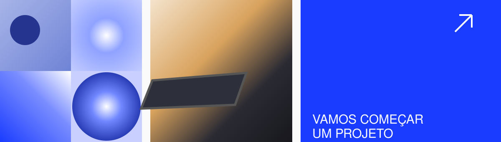

 

[**Trabalhos**](https://e7ements.vercel.app) &nbsp;·&nbsp; [**Insights**](https://e7ements.vercel.app) &nbsp;·&nbsp; [**Serviços**](https://e7ements.vercel.app) &nbsp;·&nbsp; [**Estúdio**](https://e7ements.vercel.app) &nbsp;·&nbsp; [**Contactos ↗**](mailto:seuemail@exemplo.com)

 

 

## [Quem somos]

Transformamos ideias ambiciosas em produtos digitais, marcas e experiências imersivas. Unimos pensamento estratégico e direção criativa para criar projetos que fazem sentido — e deixam impressão.

Trabalhamos lado a lado com pessoas e negócios que acreditam no valor de fazer diferente.

 

## [Serviços]

<table width="100%">
<tr><td align="left"><code>(1)</code></td><td align="right"><b>Branding</b></td></tr>
<tr><td align="left"><code>(2)</code></td><td align="right"><b>Design UI/UX</b></td></tr>
<tr><td align="left"><code>(3)</code></td><td align="right"><b>Desenvolvimento Web</b></td></tr>
<tr><td align="left"><code>(4)</code></td><td align="right"><b>Motion Graphics</b></td></tr>
<tr><td align="left"><code>(5)</code></td><td align="right"><b>Marketing Digital</b></td></tr>
</table>

 

## [Projetos Selecionados]

| (ano) | Projeto | O que fizemos |
|:--:|:--|:--|
| 2026 | **[Nome do projeto]** ↗ | [Branding / UI·UX / Web / Motion] |
| 2025 | **[Nome do projeto]** ↗ | [Branding / UI·UX / Web / Motion] |
| 2025 | **[Nome do projeto]** ↗ | [Branding / UI·UX / Web / Motion] |

 

## [Como trabalhamos]

**(1) Escutar** — entendemos o contexto, as pessoas e o desafio.

**(2) Encontrar** — definimos uma direção e construímos uma ideia com propósito.

**(3) Criar** — transformamos conceito numa experiência consistente e memorável.

**(4) Lançar** — entregamos tudo pronto para o mundo e seguimos por perto.

 

---

[Instagram](https://instagram.com/seu-perfil) &nbsp;·&nbsp; [Behance](https://behance.net/seu-perfil) &nbsp;·&nbsp; [LinkedIn](https://linkedin.com/company/seu-perfil)

[Cidade, País] &nbsp;·&nbsp; © 2026 E7EMENTS STUDIO

